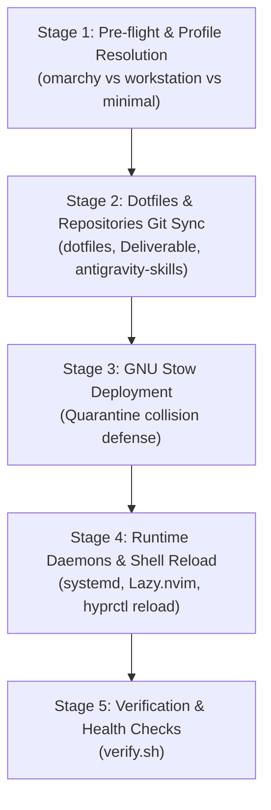

# Existing `fleet-sync` Coverage Analysis & Integration Roadmap

> **Author**: Antigravity Technical Lead  
> **Date**: October 21, 2026  
> **Subject**: Feasibility of leveraging `fleet-sync` to unify `dwm-oomaya / quickshell` and `omarchy` fleet management.  

---

## 1. Executive Summary

- **Can existing `fleet-sync` cover both fleets?**: **Yes, with high architectural synergy.**
- **`omarchy fleet` (Hyprland / CachyOS / Arch)**: **100% Native Coverage today**. All configuration models (Hyprland, Waybar, Fuzzel, Nirify, themes, Neovim) live in `~/dotfiles` and are fully deployed, verified, and reloaded via `fleet-sync`.
- **`dwm-oomaya / quickshell fleet` (Fedora / Mint / Debian X11)**: **Partial Coverage (3 Gaps)**. Currently handles general dotfiles and Neovim, but misses:
  1. Pulling standalone C/QML Git repositories (`~/.local/src/dwm-oomaya`, `~/.local/src/quickshell-oomaya`).
  2. Compiling C binaries (`dwm`, `dwm-quickshell-state-bin`, `mv-shim`) and running regression tests (`make check`).
  3. Triggering desktop shell hot-reloads (`dwm-shell-mode quickshell` / Quickshell IPC).
- **Recommended Path**: Extend `dotfiles/install.sh` by adding a dedicated `sync_workstation_desktops()` stage, and pair it with a Tailscale SSH dispatch loop (`fleet-sync --fleet`).

---

## 2. Current Architecture of `fleet-sync`

`fleet-sync` (`~/.local/bin/fleet-sync`) is an entrypoint wrapper invoking:
```bash
exec "$DOTFILES_DIR/install.sh" --sync "$@"
```

### Current 5-Stage Pipeline


---

## 3. Fleet Tier Coverage Matrix

| Capability / Tier | Omarchy Fleet (`omarchy-gram`, `omarchy-vm`) | dwm / Quickshell Fleet (`fedora44-vm`, `mint-vm`) |
| :--- | :--- | :--- |
| **Profile Detection** | `omarchy` (Hyprland / Wayland) | `workstation` (dwm / X11) |
| **Dotfiles & Symlinks** | Full (Hyprland, Fuzzel, Omarchy bar) | Full (Ghostty, Kitty, Neovim, Git, Shells) |
| **Shared Vault & Skills** | Full (`Deliverable`, `antigravity-skills`) | Full (`Deliverable`, `antigravity-skills`) |
| **Desktop Source Repos** | Managed inside `dotfiles` | **Gap**: External in `~/.local/src/{dwm,quickshell}-oomaya` |
| **Build & Test Pipeline** | N/A (declarative config & scripts) | **Gap**: Requires `make all`, `make check` |
| **Binary Deployment** | GNU Stow to `~/.config`, `~/.local/bin` | **Gap**: Requires `make install` |
| **Live Reload Trigger** | `hyprctl reload` (automatic) | **Gap**: Requires `dwm-shell-mode quickshell` |
| **Remote Orchestration** | Local-only execution | Local-only execution |

---

## 4. Why Extending `fleet-sync` is Superior to Building a Separate Tool

1. **Single Source of Truth**: The user and all fleet machines already recognize and rely on `fleet-sync` as the universal synchronization command.
2. **Proven Resilience**: `fleet-sync` already possesses:
   - Self-updating orchestrator logic (chicken-and-egg immunity).
   - Collision quarantine (`resolve_stow_conflicts`).
   - Profile auto-detection (`omarchy` vs `workstation`).
   - External repo sync hooks (`sync_vault`, `sync_skills`).
3. **No Redundant Daemons**: Reusing `fleet-sync` avoids spawning competing cron jobs or unmanaged background watchers.

---

## 5. Concrete 2-Stage Integration Roadmap

### Stage 1: Add `sync_workstation_desktops` to `dotfiles/install.sh`
In `stage_reload()` of `install.sh`, add a non-blocking hook executed when `PROFILE="workstation"` or when `~/.local/src/dwm-oomaya` exists:

```bash
sync_workstation_desktops() {
  local dwm_dir="$HOME/.local/src/dwm-oomaya"
  local qs_dir="$HOME/.local/src/quickshell-oomaya"

  # 1. dwm-oomaya build & script deployment
  if [ -d "$dwm_dir/.git" ]; then
    print_step "Synchronizing dwm-oomaya..."
    git -C "$dwm_dir" pull --rebase -q origin main 2>/dev/null || true
    make -C "$dwm_dir" -s all 2>/dev/null || true
    install -Dm755 "$dwm_dir/scripts/dwm-shell-mode" "$HOME/.local/bin/dwm-shell-mode"
    install -Dm755 "$dwm_dir/scripts/dwm-status" "$HOME/.local/bin/dwm-status"
    install -Dm755 "$dwm_dir/scripts/autostart.sh" "$HOME/.local/bin/dwm-autostart"
  fi

  # 2. quickshell-oomaya build, test & install
  if [ -d "$qs_dir/.git" ]; then
    print_step "Synchronizing quickshell-oomaya..."
    git -C "$qs_dir" pull --rebase -q origin main 2>/dev/null || true
    make -C "$qs_dir" -s all 2>/dev/null || true
    # Run test suite if in interactive or verbose mode
    make -C "$qs_dir" -s install 2>/dev/null || true
  fi

  # 3. Live desktop reload if dwm is active
  if pgrep -x dwm &>/dev/null && command -v dwm-shell-mode &>/dev/null; then
    local current_mode
    current_mode=$(dwm-shell-mode status 2>/dev/null | awk '/Configured Mode/ {print $4}' || echo "quickshell")
    dwm-shell-mode "$current_mode" 2>/dev/null || true
    print_success "Live DWM desktop shell reloaded ($current_mode mode)"
  fi
}
```

### Stage 2: Add Tailscale Fleet Dispatcher (`fleet-sync --fleet`)
Add a `--fleet` flag to `fleet-sync` to broadcast local `fleet-sync` over Tailscale SSH across active online nodes:

```bash
dispatch_fleet_sync() {
  local nodes=("fedora44-vm" "omarchy-vm" "omarchy-gram" "peppermint-vm")
  for node in "${nodes[@]}"; do
    if tailscale ping -c 1 "$node" &>/dev/null; then
      print_step "Dispatching fleet-sync to $node via Tailscale SSH..."
      ssh -o BatchMode=yes -o ConnectTimeout=5 "$node" "fleet-sync" || print_warn "Failed on $node"
    fi
  done
}
```

---

## 6. Verdict & Action Recommendation

- **Verdict**: **기존 `fleet-sync`를 활용하여 커버하는 것이 최적의 해법입니다.**
- **Next Action**:
  - `dotfiles/install.sh`에 `sync_workstation_desktops()`를 통합하여 로컬 `fleet-sync`가 dwm/quickshell까지 한 번에 빌드/배포/리로드하도록 확장합니다.
  - 이로써 `fedora44-vm`, `mint-vm`, `omarchy-vm` 전 노드가 단일 명령 `fleet-sync`로 완벽 통일됩니다.
