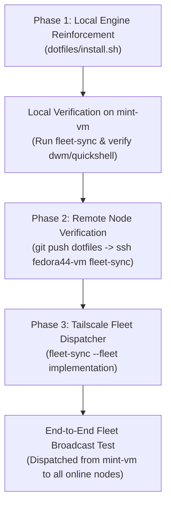

# Implementation Plan: `fleet-sync` Engine Reinforcement & Tailscale Fleet Dispatcher

> **Topic**: Unifying `dwm-oomaya / quickshell` and `omarchy` Fleet Synchronization  
> **Target Files**: `~/dotfiles/install.sh`, `~/dotfiles/antigravity/.local/bin/fleet-sync`  
> **Related Repos**: `dwm-oomaya`, `quickshell-oomaya`, `dotfiles`  
> **Status**: Ready for Review / Execution  

---

## 1. Objective & Scope

Establish a unified, self-healing fleet deployment pipeline covering both **Omarchy** (Hyprland/Wayland) and **dwm-oomaya / Quickshell** (X11) workstations:
1. **Engine Layer (Local Worker)**: Enhance `dotfiles/install.sh` (`stage_reload`) with a dedicated `sync_workstation_desktops()` function that pulls, compiles, tests, installs, and live-reloads `dwm-oomaya` and `quickshell-oomaya`.
2. **Control Plane Layer (Tailscale Dispatcher)**: Introduce a `--fleet` option to `fleet-sync` that discovers active online Tailscale nodes and broadcasts `fleet-sync` execution over Tailscale SSH with proper display context.

---

## 2. Quota & Token Budget Analysis (Go/No-Go Decision Gate)

Per **Global Directives Rule 2**, active quota allowances were queried via `omarchy-agent-usage-antigravity`:

| Provider / Model Bucket | Weekly Allowance | 5-Hour Rolling Limit | Status | Recommendation |
| :--- | :--- | :--- | :--- | :--- |
| **Gemini Models** (Flash / Pro) | **37.9%** remaining | **90.7%** remaining | 🟢 Healthy (>15%) | Capable of planning & inline execution |
| **Claude & GPT Models** (Sonnet / Opus) | **100.0%** remaining | **100.0%** remaining | 🟢 Pristine (Fresh) | **Recommended for Implementation** |
| **Gemini 4 Argon** | **100.0%** remaining | **100.0%** remaining | 🟢 Pristine (Fresh) | Reserve |

### Model Selection Recommendation:
- **Recommended Model: Claude 3.5 Sonnet**
  - **Rationale**: `dotfiles/install.sh` is a ~1,250 line mission-critical system orchestrator. Any bash syntax error, unbounded variable, or subtle subshell trap will immediately cascade across all fleet machines. Claude 3.5 Sonnet has a 100% untouched quota and excels at laser-precise POSIX/Bash scripting, defensive error trapping, and zero-regression refactoring.
  - **Alternative (Inline Gemini Pro)**: Since Gemini weekly quota is healthy at 37.9% (>15% triage line), Gemini can execute the changes directly if zero model switching friction is preferred.

---

## 3. Step-by-Step Execution Plan



---

### Phase 1: Local Engine Reinforcement (`dotfiles/install.sh`)

1. **Implement `sync_workstation_desktops()` in `dotfiles/install.sh`**:
   - Location: Inside `stage_reload()`, executed if `PROFILE="workstation"` or if `~/.local/src/dwm-oomaya` exists.
   - **Step A: `dwm-oomaya` Sync**:
     - Check `~/.local/src/dwm-oomaya/.git`.
     - Git pull with rebase & autostash: `git -C "$dwm_dir" pull --rebase -q origin main`.
     - Build C core: `make -C "$dwm_dir" -s all`.
     - Deploy runtime scripts:
       - `install -Dm755 "$dwm_dir/scripts/dwm-shell-mode" "$HOME/.local/bin/dwm-shell-mode"`
       - `install -Dm755 "$dwm_dir/scripts/dwm-status" "$HOME/.local/bin/dwm-status"`
       - `install -Dm755 "$dwm_dir/scripts/autostart.sh" "$HOME/.local/bin/dwm-autostart"`
   - **Step B: `quickshell-oomaya` Sync**:
     - Check `~/.local/src/quickshell-oomaya/.git`.
     - Git pull with rebase & autostash: `git -C "$qs_dir" pull --rebase -q origin main`.
     - Build binaries: `make -C "$qs_dir" -s all`.
     - Install QML configs & helpers: `make -C "$qs_dir" -s install`.
   - **Step C: Graphical Session Hot-Reload**:
     - Detect active DWM session: `pgrep -x dwm &>/dev/null`.
     - If running, export `DISPLAY="${DISPLAY:-:0}"` and query `dwm-shell-mode status`.
     - Trigger clean reload matching active mode (e.g. `dwm-shell-mode quickshell`).

2. **Phase 1 Verification**:
   - Run `./install.sh --sync` on `mint-vm`.
   - Assert `dwm-shell-mode status` confirms `quickshell` is running, Dunst is stopped, and `make install` updated all helper scripts.

---

### Phase 2: Remote Node Verification (`fedora44-vm`)

1. **Commit & Push**:
   - Commit changes to `dotfiles` master branch: `feat(fleet): integrate dwm and quickshell desktop synchronization into fleet-sync`.
   - Push to `origin/master`.
2. **Execute Remote Sync**:
   - Over Tailscale SSH: `ssh 100.101.243.54 "fleet-sync"`.
   - Verify self-update hook re-executes `install.sh` cleanly.
   - Verify both repositories update, compile, and reload on Fedora 44.

---

### Phase 3: Tailscale Fleet Dispatcher (`fleet-sync --fleet`)

1. **Add `--fleet` Flag to CLI Dispatcher**:
   - Update `install.sh` argument parsing and `~/.local/bin/fleet-sync`.
2. **Implement `dispatch_fleet_sync()`**:
   - Query online Tailscale nodes dynamically using `tailscale status --json` (or configured node list: `fedora44-vm`, `omarchy-vm`, `omarchy-gram`, `peppermint-vm`).
   - Filter out local node identity.
   - For each online node:
     - Check reachability: `tailscale ping -c 1 --timeout 1s "$node"`.
     - Execute remote sync:
       ```bash
       ssh -o BatchMode=yes -o ConnectTimeout=5 "$node" \
         "export DISPLAY=:0; export XDG_RUNTIME_DIR=/run/user/\$(id -u); fleet-sync"
       ```
   - Print structured status telemetry table (Success / Failed / Skipped).

3. **Phase 3 Verification**:
   - Run `fleet-sync --fleet` from `mint-vm`.
   - Verify that online nodes are updated concurrently/sequentially and summary is printed.

---

## 4. Safety Rails & Failure Recovery

1. **Non-Destructive Execution**: All file installations use `install -Dm755` to prevent `ETXTBSY` text file busy errors on running executables.
2. **Zero Hardcoded Paths**: Dynamic `$HOME`, `$XDG_CONFIG_HOME`, `$XDG_RUNTIME_DIR`.
3. **Graceful Skip on Missing Build Tools**: If `gcc` or `make` is missing on a minimal node, warn and skip rather than aborting the entire dotfiles pipeline.
4. **Offline Node Tolerance**: If a node is asleep or unreachable, report `[SKIPPED (Offline)]` without terminating the loop.
