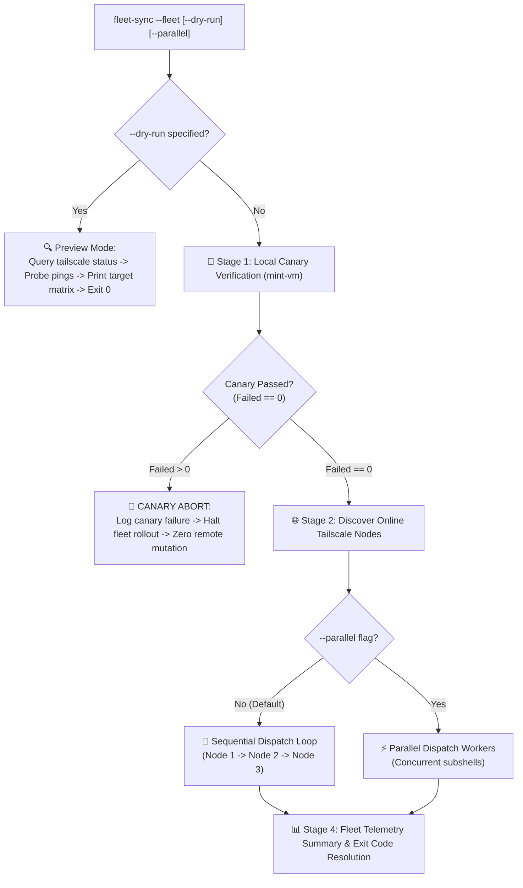

# One-Page Design: Tailscale Fleet Dispatcher (`fleet-sync --fleet`)

> **Author**: Antigravity Technical Lead & Systems Architect  
> **Status**: **APPROVED & SIGNED-OFF** (with Human Partner Amendments)  
> **Scope**: Remote coordination across Omarchy (Hyprland) and DWM/Quickshell nodes  
> **Prerequisites**: Phase 1 local engine (`install.sh`) complete & Phase 2 verified  

---

## 1. Architectural Philosophy & Core Tenets

1. **Canary-First Principle (0-Failed Gate)**: Never dispatch to remote nodes until the local canary node (`mint-vm`) passes with **`0 Failed`**. Benign warnings (such as `omarchy-ctl DEGRADED` on X11 nodes) are tolerated and surfaced in telemetry, preventing permanent gate lockout. If canary reports any failures, rollout immediately halts.
2. **Sequential Default with Failure Isolation**: Remote execution defaults to **sequential dispatch** (predictable, one node at a time) to eliminate fleet-wide concurrency storms. Parallel dispatch is available as an explicit opt-in (`--parallel`). A failure on Node A never halts Node B.
3. **Reproducible Per-Node Logs**: Every run writes raw stdout/stderr into dedicated, timestamped per-node files for auditability.
4. **Dry-Run Predictability**: An explicit `--dry-run` flag visualizes targets, online states, and commands without executing any mutations.
5. **v1 Scope Boundary**: Automated multi-node rollback is formally **Out of Scope for v1** (individual node recovery remains manual via Git HEAD reset).

---

## 2. CLI Interface & Flag Specification

```text
Usage: fleet-sync [OPTIONS]

Options:
  --sync               Run local 5-stage synchronization pipeline (default)
  --fleet              Broadcast fleet synchronization across all online Tailscale nodes (Sequential by default)
  --parallel           (Used with --fleet) Enable concurrent multi-node dispatch instead of sequential
  --dry-run, -n        (Used with --fleet) Preview target nodes and actions without execution
  --canary <node>      Override canary target (Default: local node / mint-vm)
  --nodes <n1,n2...>   Target specific subset of fleet nodes (Default: all online nodes)
```

---

## 3. End-to-End Execution Flow



---

## 4. Key Mechanism Specifications

### 4.1. Local Canary Gate (`mint-vm`)
Before initiating any remote SSH connection:
1. Run local `./install.sh --sync` and `./verify.sh --profile workstation`.
2. **0-Failed Gate Criterion**: Assert that `verify.sh` completes with **`0 Failed`** checks and zero broken symlinks. Benign warnings (such as `omarchy-ctl DEGRADED` on X11) are tolerated and surfaced in telemetry, preventing permanent lockouts on healthy desktop configurations.
3. If canary encounters any hard failure (`Failed > 0`), print `[CANARY FAILED]` with failing vectors and abort fleet rollout with exit code `2`.

### 4.2. Dry-Run Mode (`--dry-run`)
When `--dry-run` is invoked:
1. Parse online nodes via `tailscale status --json` (ignoring offline/self).
2. Run single ping probe `tailscale ping -c 1 --timeout 1s <node>` to measure RTT.
3. Print a formatted matrix:
   ```text
   FLEET PREVIEW (DRY-RUN):
   Node             Tailscale IP     Status   RTT      Role/Profile    Planned Action
   ----------------------------------------------------------------------------------
   mint-vm (Local)  100.118.69.27    ONLINE   0.0ms    Canary (Local)  ./install.sh --sync
   fedora44-vm      100.101.243.54   ONLINE   1.2ms    Workstation     ssh -> fleet-sync
   omarchy-vm       100.124.231.48   ONLINE   1.4ms    Omarchy         ssh -> fleet-sync
   peppermint-vm    100.126.37.73    ONLINE   0.9ms    Workstation     ssh -> fleet-sync
   win11-pc         100.126.57.34    ONLINE   -        Windows         [SKIPPED (Non-Linux)]
   ```
4. Exits cleanly with zero remote writes.

### 4.3. Per-Node Failure Isolation & Logging
- **Log Destination**:
  `$HOME/.local/state/dotfiles/fleet-logs/<TIMESTAMP>/<NODE_NAME>.log`
  *(e.g., `~/.local/state/dotfiles/fleet-logs/20261021_140000/fedora44-vm.log`)*
- **Remote Execution Command**:
  ```bash
  ssh -o BatchMode=yes -o ConnectTimeout=5 "$node_ip" \
    "bash -l -c 'export DISPLAY=\${DISPLAY:-:0}; export XDG_RUNTIME_DIR=\${XDG_RUNTIME_DIR:-/run/user/\$(id -u)}; fleet-sync'" \
    > "$log_file" 2>&1
  ```
- **Error Boundary**:
  Each node runs in a subshell block. If Node A fails (e.g. exit 1), `NODE_STATUS[fedora44-vm]="FAIL"` is recorded, but the dispatch loop immediately continues to Node B.

### 4.4. Telemetry Reporting Table
Upon completion of all online targets, a clean summary table is printed:
```text
================================================================================
  FLEET ROLLOUT SUMMARY [2026-10-21 14:05:22]
================================================================================
  Node             Status   Duration   Log Location
  ------------------------------------------------------------------------------
  mint-vm          PASS     4.2s       .../fleet-logs/20261021_140000/mint-vm.log
  fedora44-vm      PASS     8.1s       .../fleet-logs/20261021_140000/fedora44-vm.log
  omarchy-vm       PASS     6.4s       .../fleet-logs/20261021_140000/omarchy-vm.log
  peppermint-vm    WARN     7.2s       .../fleet-logs/20261021_140000/peppermint-vm.log
================================================================================
  Result: 3 Passed, 1 Warning, 0 Failed. All nodes isolated and archived.
```

---

## 5. Decision Gate for Human Partner Sign-Off

- **Sign-Off Required**:
  1. Approval of the **Canary-First** gate (mint-vm must be 100% green before remote rollout).
  2. Approval of the **`--dry-run`** matrix format.
  3. Approval of **per-node isolated logging** under `~/.local/state/dotfiles/fleet-logs/<timestamp>/`.
