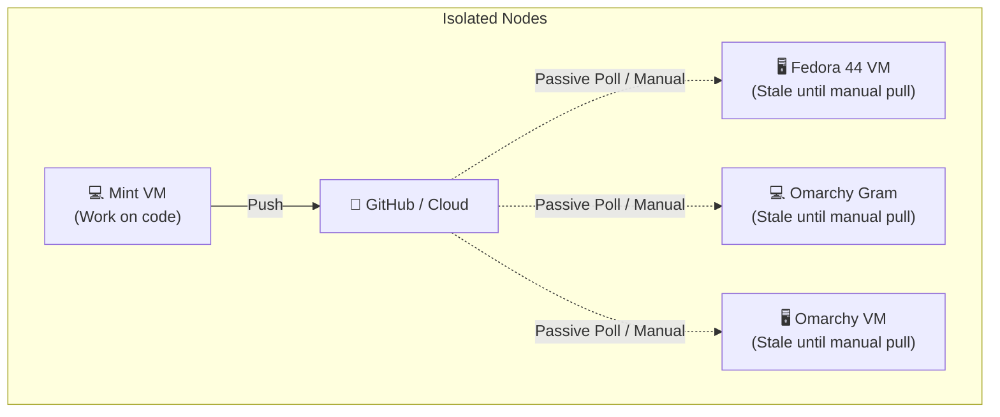
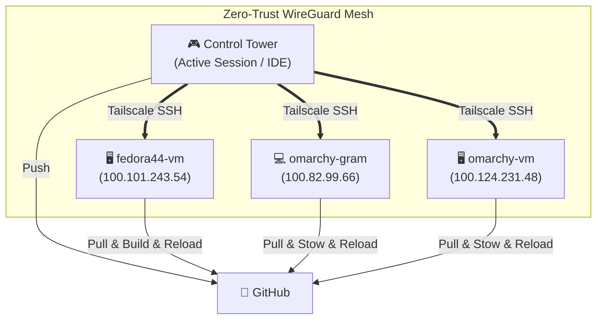

# Tailscale Fleet Management: Mental Model, Superpowers & Trade-offs

> **Author**: Antigravity Technical Lead  
> **Date**: October 21, 2026  
> **Audience**: Architecture & Engineering Review  
> **Topic**: Transforming Fleet Coordination via Tailscale WireGuard Mesh  

---

## 1. The Core Mental Model Shift

### Before Tailscale: The Passive Island Model (Pull-Based)

- **Structure**: Each machine is an isolated island with no direct visibility into other machines.
- **Workflow**:
  1. You write a fix on Machine A (e.g., Linux Mint) and push to GitHub.
  2. Machine B (Fedora) and Machine C (Gram) remain stale.
  3. You only discover bugs on Machine B days later when you sit in front of it to do work, disrupting your flow.
- **Nature**: Asynchronous, fragmented, reactive, high human context-switching cost.

---

### After Tailscale: The Unified Distributed Control Plane (Mesh / Push-Triggered)

- **Structure**: All devices form an encrypted, flat, direct P2P mesh network, regardless of NAT, hypervisor virtual networks, or physical location.
- **Workflow**:
  1. You write code on your current machine and push to GitHub.
  2. From that *exact same terminal*, you broadcast a fleet deployment:
     `fleet-sync --fleet` (or dispatch over Tailscale SSH).
  3. Remote machines pull, build, run test suites, and live-reload their desktop UI while you observe real-time telemetry.
- **Nature**: Synchronous verification, proactive, single-pane-of-glass management.

---

## 2. The Core Separation of Concerns

To avoid mental clutter, distinguish these three components:

| Component | Role | Analogy | Example in Our Stack |
| :--- | :--- | :--- | :--- |
| **Worker / Engine** | Executes local compilation, stow, and UI reload | **Mechanic on the ground** | `fleet-sync` (`install.sh`) |
| **Highway / Transport** | Encrypted zero-trust communication mesh | **Private highway system** | **Tailscale WireGuard + SSH** |
| **Dispatcher / Control** | Dispatches tasks to online nodes and aggregates logs | **Flight control tower** | `fleet-sync --fleet` / `tailscale status` |

---

## 3. What Gets Drastically Better (Superpowers)

### 1. Instant Cross-Distro CI/CD in Real Time
- **Pain Eliminated**: "It worked on Mint, but broke on Fedora because `qmllint` was missing or theme configs had symlink security checks."
- **Superpower**: You can test and verify real OS environments (Fedora 44, Arch, Mint) within seconds directly from your pairing session, without touching VM consoles.

### 2. Zero-Configuration Remote Access (No SSH Key Rot)
- Traditional SSH requires managing `~/.ssh/authorized_keys`, static local IP assignments, router port forwarding, or Dynamic DNS.
- **Tailscale SSH**: Authentication is tied to your identity provider. Adding or replacing a machine requires zero SSH key copying.

### 3. Live UI Hot-Reload & Remote Diagnostics
- If a machine's UI freezes or an experimental QML/DWM patch misbehaves, you don't need hypervisor console access or a hard power cycle.
- Remotely run `ssh <node> 'dwm-shell-mode suckless'` to instantly recover the desktop.

### 4. Continuous Living Handoff Synchronization
- Ephemeral memory checkpoints (`antigravity-handoff`) and git branch statuses can be queried across all nodes instantaneously.

---

## 4. Trade-offs, Costs & Risks

| Category | Trade-off / Risk | Mitigation in Our Design |
| :--- | :--- | :--- |
| **External Dependency** | Tailscale coordination server is needed for initial node discovery / DERP relay (though data packets are P2P). | Direct local LAN fallback; offline nodes continue using local `fleet-sync`. |
| **Security & Blast Radius** | Compromising one node could expose SSH access to other nodes on the tailnet. | Use Tailscale ACLs with tag restrictions (e.g. `tag:workstation` can only be SSH'd into by `tag:dev`). |
| **Active Session Interruption** | Dispatching an update while someone is actively typing in Neovim or moving windows could be disruptive. | `install.sh` uses atomic non-destructive replacement (`install -Dm755`, collision quarantine, autostash). |
| **Daemon Overhead** | Every machine runs `tailscaled` service. | Resource usage is minimal (~20-30MB RAM, zero idle CPU on modern kernels). |

---

## 5. Critical Blind Spots (What You Might Overlook)

### Blind Spot 1: Headless SSH vs Graphical Session Context (`DISPLAY` / `XDG_RUNTIME_DIR`)
- **The Trap**: A plain SSH shell has no `DISPLAY` or `WAYLAND_DISPLAY` variable set. If you run `dwm-shell-mode quickshell` or `quickshell ipc` over SSH, it will fail with `Cannot open display` or `Cannot find socket`.
- **The Solution**: The remote dispatch script must dynamically detect the running display:
  ```bash
  export DISPLAY="${DISPLAY:-:0}"
  export XDG_RUNTIME_DIR="${XDG_RUNTIME_DIR:-/run/user/$(id -u)}"
  ```

### Blind Spot 2: Non-Interactive Escalation (Sudo / Polkit)
- **The Trap**: Over SSH batch mode, commands cannot display a graphical `pkexec` prompt or wait for an interactive `sudo` password. Any step that attempts to run `sudo apt` or `sudo dnf` will hang or fail.
- **The Solution**: Sovereign fleet tools must operate strictly in user-space (`$HOME/.local/bin`, `$HOME/.config`). System binary installations must be optional or guarded with `sudo -n`.

### Blind Spot 3: Offline & Sleep States (Laptops & Suspended VMs)
- **The Trap**: Laptops (`omarchy-gram`) on battery or suspended VMs will be offline when you dispatch an update. A naive blocking loop will hang or abort.
- **The Solution**: The dispatcher must probe availability (`tailscale ping -c 1 --timeout 1s <node>`) and execute asynchronously or mark unreachable nodes for "pull on next wake" via the existing on-launch hook.

---

## 6. Summary Comparison Matrix

| Dimension | Before (Passive Pull) | After (Tailscale Orchestration) |
| :--- | :--- | :--- |
| **Update Trigger** | Manual on each individual machine | Single push from developer machine |
| **Testing Feedback** | Delayed until next login on that machine | Immediate (<60s feedback loop) |
| **Network Barrier** | Blocked by NAT / Firewalls / Routers | Seamless global encrypted WireGuard mesh |
| **SSH Management** | Public keys, port forwards, static IPs | Zero-trust Identity-based SSH |
| **Fleet Visibility** | Blind | Real-time health, git head, and process status |
